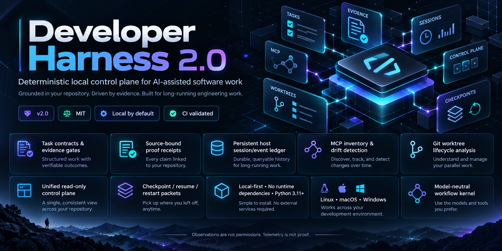

<p align="center"></p>

# Developer Harness

**A dependable working environment for your AI coding tool. Personalized in a conversation. Grounded in your repository.**

Turn “build this” into a clear contract, bounded work, current verification, and a useful handoff. Keep your editor, model, and stack. Developer Harness supplies the operating discipline and a small executable core.

Python 3.11+ · No runtime dependencies · Local by default · MIT

## Start with your AI

Download or clone this repository, open it in your AI-enabled editor, and say:

> Read START_HERE.md. Install Developer Harness into my project and personalize it for the way I work. My goal is [your goal], my tools are [your tools], and I prefer [your working style]. Inspect the project first and preserve its existing instructions.

Your AI follows the included onboarding protocol, inspects the actual project, picks a profile, configures meaningful checks, and leaves a verified first handoff. It only needs to ask about choices it cannot infer.

For a new project, use this repository as a starting point and say:

> Read START_HERE.md. Personalize this workspace for [what I want to build]. Start with the smallest useful result and show me how it will be verified.

## What you get

| Capability | What it changes |
| --- | --- |
| Task contracts | Every substantial task has an outcome, criteria, scope, risk, owner, and dependencies. |
| Evidence gates | “Done” requires current acceptance proof and a passing review. |
| Stale-proof detection | Source, configuration, environment, or proof changes invalidate receipts. |
| Restart packets | Resume after a context reset, rate limit, model switch, or interrupted session. |
| Bounded checks | Named commands, time/output limits, check-count budgets, and repeated-failure stops. |
| Precise reuse | Reuse successful checks only for the same fingerprint and acceptance mapping. |
| Governed memory | Candidates become decisions through review; source changes and expiry remain visible. |
| Safe repository overlay | Inspect an installation plan, preserve owner files, detect local edits, and uninstall managed files. |
| Portable workflows | Personalization, discovery, delivery, debugging, research, review, release, and bounded unattended work. |

The CLI never calls a model API. It runs alongside your existing AI tool. Network isolation, actual provider spending limits, reviewer identity, and agent scheduling belong to that host. See [capability boundaries](docs/CAPABILITIES.md).

## Manual quick start

From this checkout, initialize a workspace:

```bash
python dh.py init --profile general
python dh.py discover
python dh.py doctor
python dh.py profiles
```

Install into an existing repository by passing its path as `--root`:

```bash
python dh.py --root /path/to/project install --profile web-api --adapter claude
python dh.py --root /path/to/project install --profile web-api --adapter claude --apply
```

The first command prints a plan. The second applies it. In the target project, use:

```bash
python .developer-harness/dh.py --root . doctor
```

On Windows, `py -3.11` or a newer installed interpreter can replace `python`. Quote paths containing spaces. Git is optional; without it, built-in exclusions apply and Git metadata is unavailable.

## A complete first task

After your AI has configured a real project check named `test`:

```bash
python dh.py task new "Fix the parser" --objective "Valid input parses correctly" --criterion "The regression example passes" --scope . --owner builder
```

Use the returned task ID and current version for each mutation:

```bash
python dh.py task move TASK_ID active --expect 1 --reason "Scope understood"
python dh.py run TASK_ID --check test --criterion c1 --expect 2
python dh.py task move TASK_ID verifying --expect 2 --reason "Implementation complete"
python dh.py verify TASK_ID
python dh.py task move TASK_ID review --expect 3 --reason "Current evidence passes"
python dh.py review TASK_ID --expect 4 --reviewer builder --verdict pass --notes "Reviewed regression proof and diff"
python dh.py task move TASK_ID done --expect 4 --reason "Acceptance and review complete"
```

`TASK_ID` is a placeholder. A self-review remains a self-review; high-risk and assured tasks require an independent review attestation. Passing a command does not establish that it tests the right behavior. The task owner and reviewer must check that mapping.

## Built for long work

```bash
python dh.py checkpoint TASK_ID --expect 2 --summary "Parser implemented; edge cases pending" --next "Test malformed input" --blockers "none"
python dh.py resume TASK_ID
python dh.py backup --output .harness/backups/session.sqlite3
python dh.py export --output .harness/exports/session.json
```

The local SQLite ledger is the authoritative task history. The backup is restorable; JSON exports support inspection and handoff. Keep backups outside the working directory too. See [recovery](docs/RECOVERY.md).

## Explore

| Guide | Purpose |
| --- | --- |
| [START_HERE.md](START_HERE.md) | Natural-language installation and personalization |
| [QUICKSTART.md](QUICKSTART.md) | Small, runnable walkthrough |
| [Architecture](docs/ARCHITECTURE.md) | Modules, boundaries, and state machine |
| [CLI and configuration](docs/REFERENCE.md) | Commands, defaults, exit codes, and configuration |
| [Workflows](workflows/README.md) | Load the playbook relevant to the task |
| [Research and design](research/README.md) | Current primary sources and design choices |
| [Security](SECURITY.md) | Trust boundaries and operational limits |
| [Release validation](docs/VALIDATION.md) | What was actually checked |

## Develop and contribute

```bash
python -m unittest discover -s tests -v
python scripts/release_check.py
```

The source checkout runs without pip. Optional packaging uses a standard PEP 517 build. CI covers Python 3.11–3.13 on Linux, Windows, and macOS. Local release validation is reported separately from unexecuted hosted CI.

See [CONTRIBUTING.md](CONTRIBUTING.md), [CHANGELOG.md](CHANGELOG.md), and [LICENSE](LICENSE).
