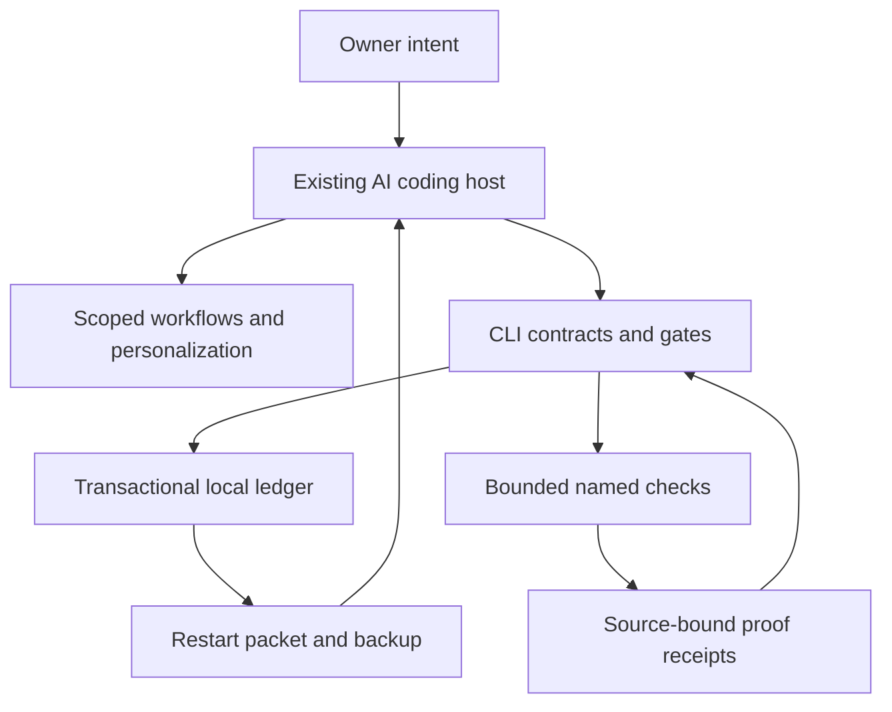
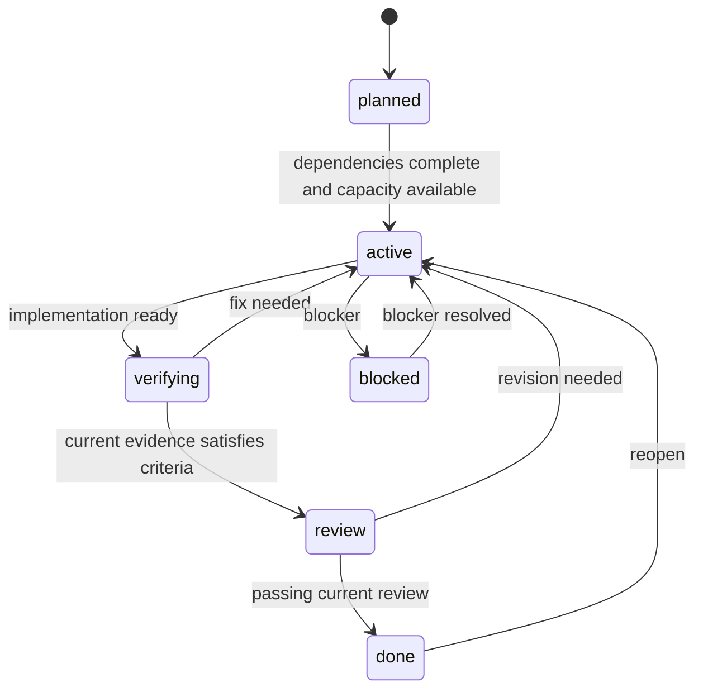

# Architecture

Developer Harness has two cooperating parts: a deterministic local runtime and small, task-specific instructions for the AI tool the owner already uses. The runtime does not implement an LLM agent loop.

## Ownership boundaries

| Layer | Owns | Does not establish |
| --- | --- | --- |
| Owner/project | Intent, domain rules, authorization, acceptance meaning | That a passing tool result tests the right behavior |
| AI host | Reasoning, edits, model choice, sandbox, credentials, real scheduling | Automatic correctness or review independence |
| Harness config | Profile, communication, checks, required gates, local limits | Provider permissions or network isolation |
| Ledger | Task versions, history, proof metadata, checkpoints, memory | Remote synchronization or hostile-user authentication |
| Runner | Named argv execution, time/output bounds, receipts, exact cache | A security sandbox or global provider-cost control |

## Executable core

- `config.py`: strict versioned configuration and profiles.
- `util.py`: repository-relative paths, exclusions, fingerprints, atomic file replacement, redaction.
- `store.py`: SQLite transactions, compare-and-swap task versions, append-only-by-API event history, export and consistent backup.
- `engine.py`: acceptance contracts, transitions, dependency gates, reviews, checkpoints, leases, memory, and external-usage records.
- `runner.py`: no-shell named checks, bounded output/time, cache and loop-stop rules.
- `context.py`: structural discovery and bounded restart packets.
- `install.py`: dry-run overlay, managed blocks, conflict detection, rollback on ordinary write failures, and uninstall.
- `cli.py`: command/exit-code boundary.

## State machine

Cancellation and recovery transitions are listed by `task move --help` and in the reference. Moving to verifying is a declaration; moving to review or done is checked by code. No state transition merges, deploys, sends messages, or authorizes an external action.

## Receipt design

A fingerprint binds the acceptance contract, scoped file-content hashes, Git HEAD/branch when available, complete harness configuration, Python version, OS, and machine architecture. Each receipt records the named command, timestamps, result, mapped criteria, elapsed time, and hash of the redacted bounded log. A successful command whose scoped input changes during execution is rejected as `inputs_changed`.

Only a fresh passing receipt with an intact proof artifact can satisfy a criterion. Required checks must be automatic check receipts. Manual observations are distinct attestations. The latest check result for a command/fingerprint supersedes earlier results; an unresolved failure cannot be hidden behind an earlier pass or cache hit. A later failing review likewise supersedes an earlier passing review for the same fingerprint.

Fingerprint boundaries are explicit. Ignored/generated/private files, dependency installation state, external services, host tool configuration, the executable's binary contents, and arbitrary environment state are not fully fingerprinted. Include manifests/lockfiles and all relevant source paths; use `--no-cache` for environmental or integration checks. Use an isolated, pinned environment when stronger reproducibility is needed. The cache makes no semantic-equivalence claim.

## Persistence and collaboration

`.harness/state.sqlite3` is authoritative local runtime state. `.harness/config.json` and `.harness/PERSONALIZATION.md` are owner-maintained, versionable project configuration. Runtime database, logs, exports, and install manifests are ignored by Git. JSON exports are inspection artifacts, not a competing state authority. Consistent SQLite backups support restoration.

SQLite uses transactions and WAL for multiple local processes. Task transitions require the current version. Advisory path leases detect overlapping declared work; they do not intercept editors. Use separate worktrees and separate local ledgers for concurrent writers. Do not put the live SQLite database on a network share or merge binary databases in Git.

## Design decisions

1. A small executable kernel is easier to verify and extend than a large collection of mandatory services.
2. Source-bound proof and explicit failure states are more useful than a global “quality score.”
3. Context is a budget: pointers first, optional excerpts second, explicit omissions always.
4. Memory records retain source provenance, scope, expiry, uncertainty, and supersession.
5. Unattended work requires bounded authorization in the host. The core can prepare a queue and receipts without pretending to schedule or reason.
6. Integrations are opt-in metadata and playbooks until a concrete implementation and its contract tests exist.
